# Diagrams

Visual maps of the system. Mermaid renders on GitHub.

## 1. UML class diagram: core models

Frozen dataclasses; every one is immutable.

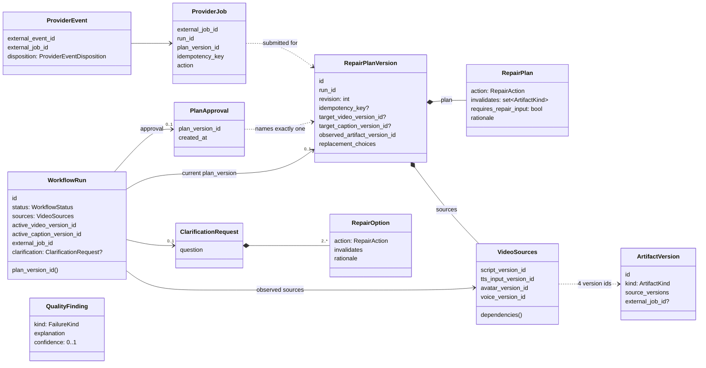

The planner is the pure function between findings and plans:

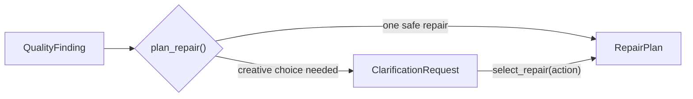

## 2. Database tables (ER)

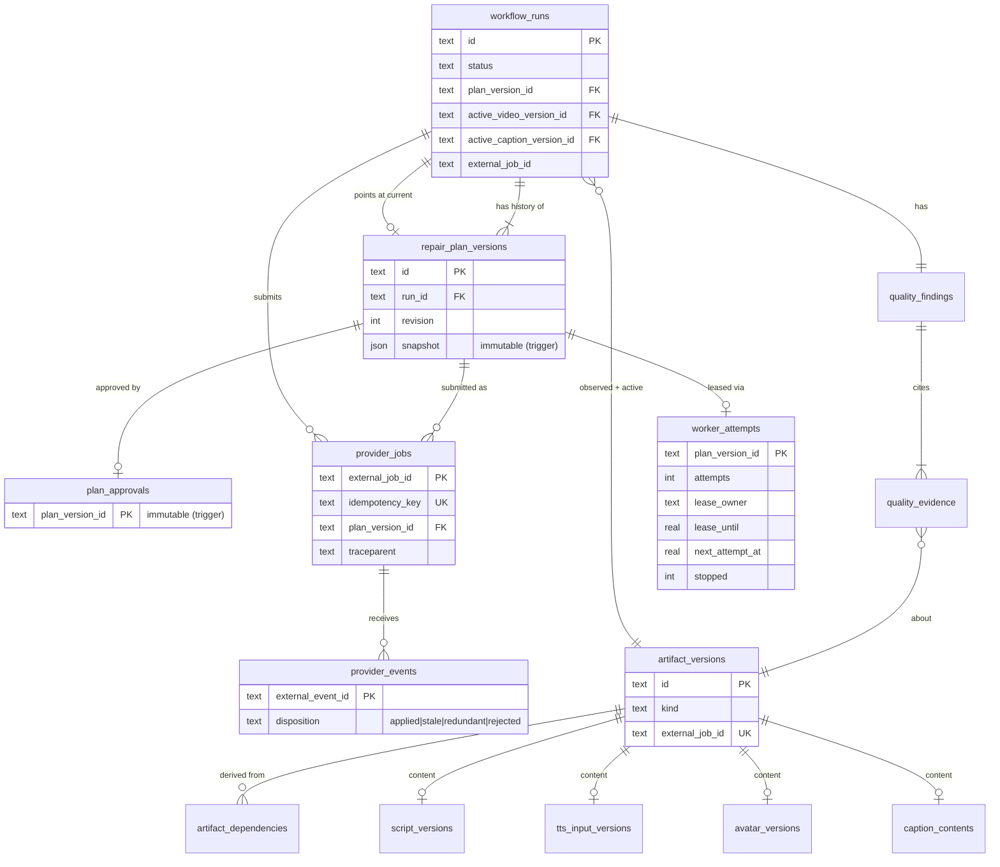

`worker_policy` (one row: capacity, attempts, lease, backoff) is omitted.

## 3. Packages: who imports whom

Arrows point at the dependency. Lower layers never import upper ones.

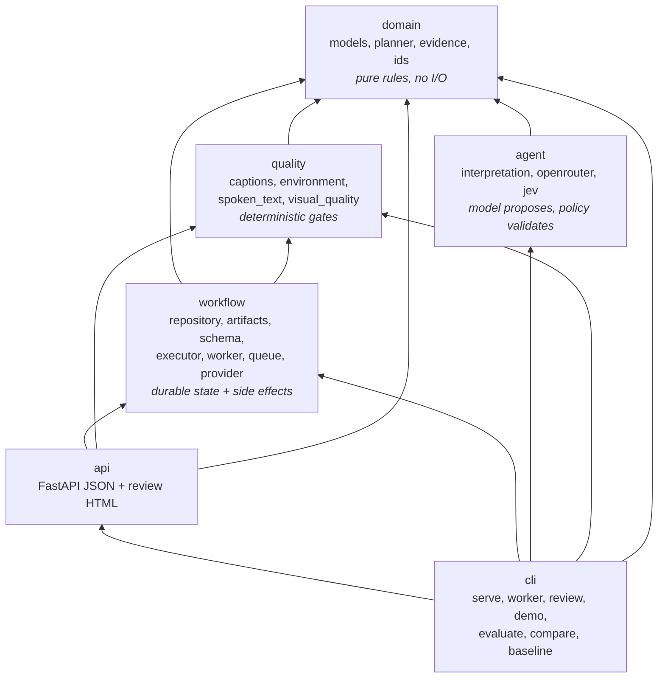

Note that `workflow` never imports `agent`: the model has no path to durable
state.

## 4. Runtime: the processes and stores

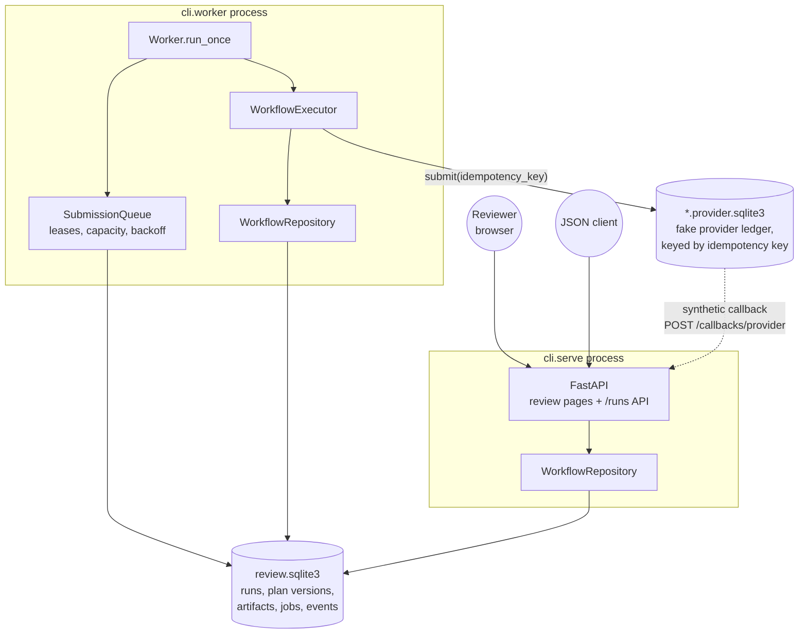

The two processes share nothing but the SQLite file. The fake provider is a
separate database so it survives a worker crash, like a real external service.

## 5. Artifact lineage

Every artifact is an immutable version. Arrows read "is derived from".

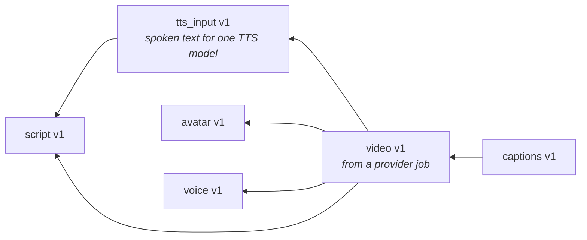

A repair replaces one node and invalidates everything to its left that depends
on it. Everything else is kept.

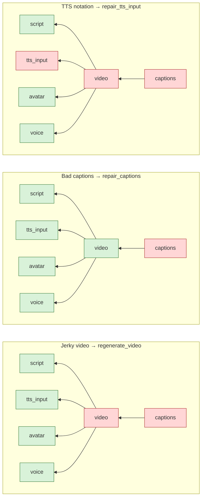

Green is kept, red is replaced. A script revision turns everything except
avatar and voice red; an avatar change turns avatar, video, and captions red.

## 6. Run lifecycle (state machine)

`WorkflowStatus`, with the repository method that causes each transition.

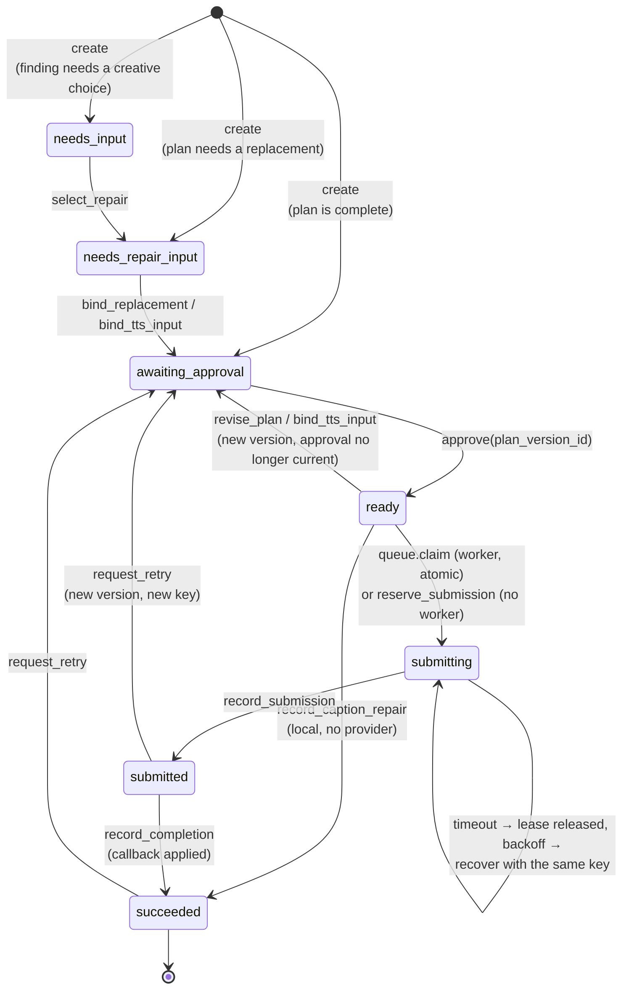

Every arrow except the worker's appends or checks a plan version, and every
reviewer command must name the version it was decided against
(`expected_plan_version_id`), so a stale page gets a 409 instead of acting on a
plan the reviewer never saw.

A run that runs out of recovery attempts, or hits a non-retryable provider error,
stays in `submitting` with its capacity slot held, because the provider may have
accepted the job. Nothing in the code resolves it yet (#87). A worker that lost
its lease changes nothing and returns `lease_lost`.

## 7. Sequence: approval to replacement video

The happy path, then the crash in the middle of it.

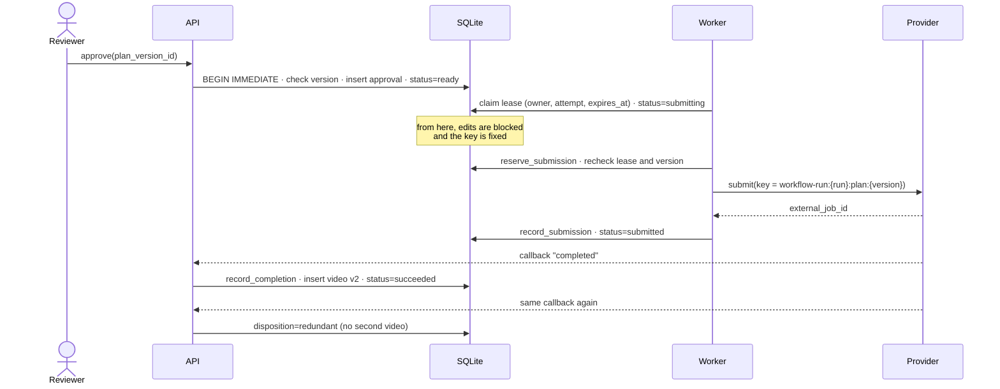

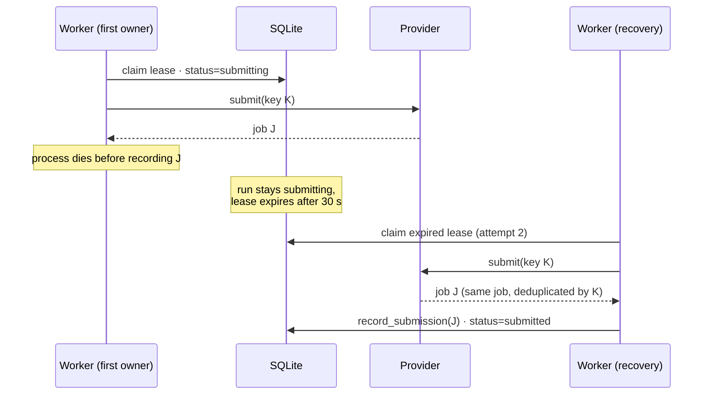

## 8. Verification: which check covers which guarantee

The hand-written tests force chosen orderings. The Hypothesis state machine
runs the real code in random orders; the Quint model samples interleavings of
a simplified protocol. Dashed arrows are witnesses the Quint simulator must
break.

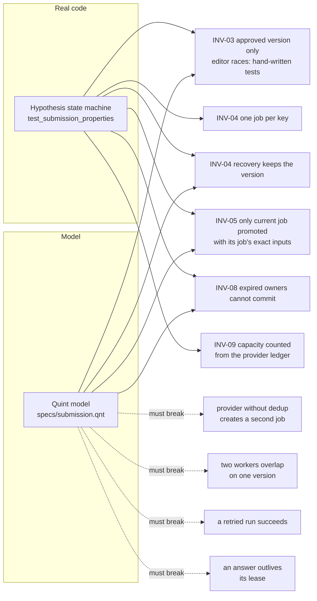

## 9. Evaluation: what runs offline and what gets recorded

Each command replays committed inputs, so CI needs no model and no API key.
`scripts/check.sh` runs all three.

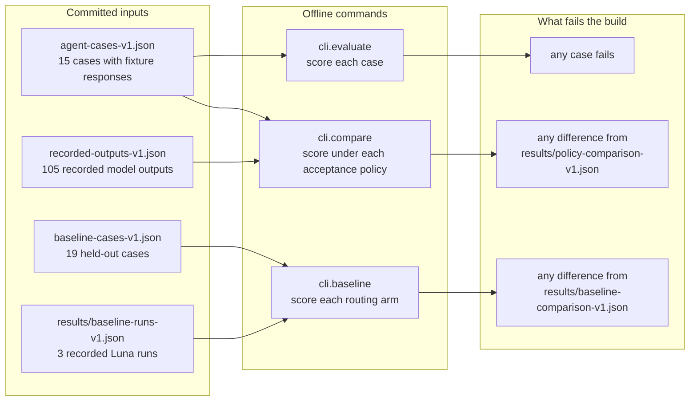

`cli.compare` also fails if the fixtures don't pass under every policy, with or
without a snapshot.

The baseline compares three routing arms. Every arm sees the same evidence.

| Arm | Gate has a finding | Gate is silent |
| --- | --- | --- |
| `rules_only` | Gate decides | Human diagnoses |
| `single_shot` | Model decides, with the gate's evidence as input | Model decides |
| `layered` | Gate decides | Model decides |

If the model abstains or its output is rejected, the case goes to a human.

Recording new outputs is separate, billed, and refuses to start unless
`MEDIA_QC_ALLOW_PAID=1` is set.

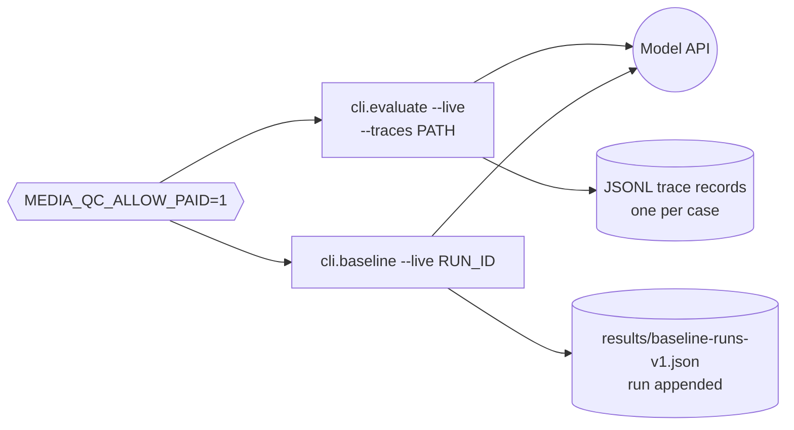

None of these commands imports `workflow`: evaluations measure routing and
validation, not the worker or the database.

## 10. Observability: events flow out, never back

Workflow events are emitted after their transaction commits. A failing sink
cannot retry provider work or undo a commit (INV-10).

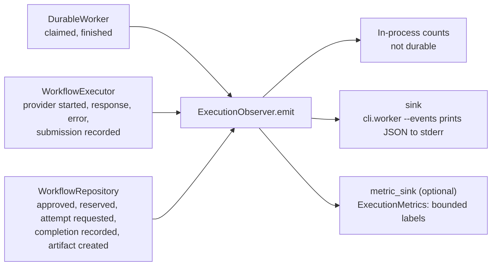

Traces connect a submission to its later callback through the database, because
the two happen far apart in time.

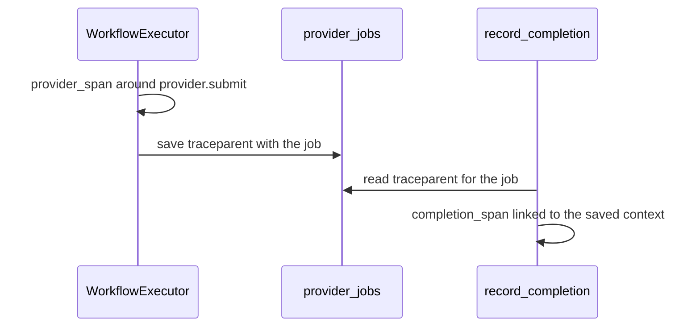

Model turns are traced separately (`agent/tracing.py`). Spans hold only
allowlisted, hashed attributes. Full synthetic inputs and outputs go only in the
evaluator's JSONL records, joined to spans by trace ID (ADR 0024). Spans go
nowhere unless an OpenTelemetry SDK is configured at the assembly edge.
